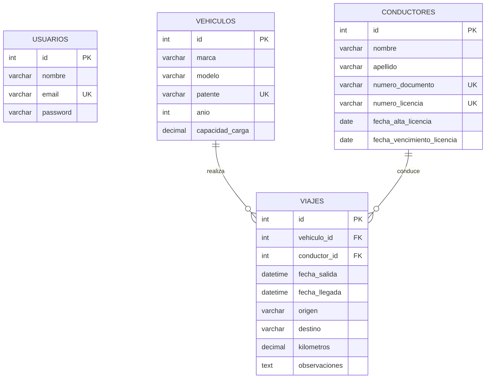

## Modelo de datos

## Decisiones de diseño

- La tabla `viajes` resuelve la relación muchos a muchos entre vehículos y conductores.
- Restricciones `UNIQUE` en email, patente, número de documento y número de licencia.
- Sin `ON DELETE CASCADE`, para no perder el historial de viajes: no se puede borrar un vehículo o conductor con viajes asociados.
- `DECIMAL` para los kilómetros y la capacidad de carga.
- Contraseñas encriptadas con bcrypt.
- JWT con expiración de 4 horas.
- Rutas protegidas con Passport (`passport-jwt`).